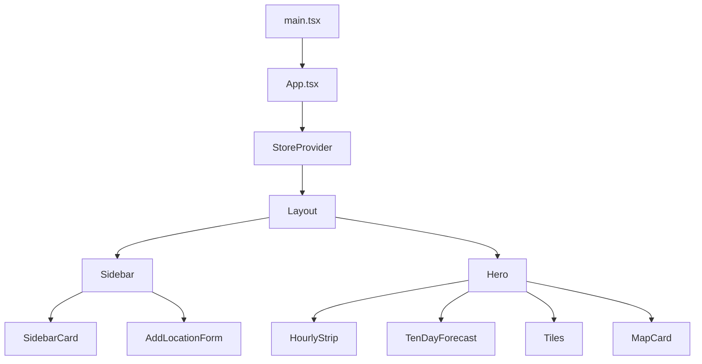
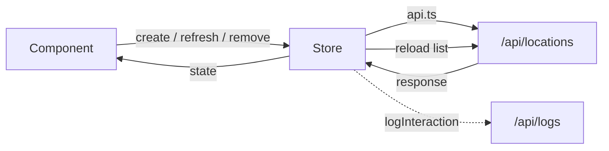

The frontend is a React 18 app built with Vite, styled with Tailwind CSS, and uses Leaflet (`react-leaflet`) for the map. API calls use relative `/api` paths so they work in both the combined dev server and production.

## Component tree

## State

`state/store.tsx` holds shared state in a React context, exposed through `useStore()` and `useSelectedLocation()`.

| State          | Meaning                                     |
| -------------- | ------------------------------------------- |
| `locations`    | Saved locations with their snapshots        |
| `selectedId`   | Selected location (falls back to the first) |
| `isAdding`     | Whether the add-location form is open       |
| `isLoading`    | Initial load in progress                    |
| `refreshingId` | Location currently being refreshed          |
| `error`        | Latest API error                            |

Actions: `select`, `setAdding`, `create`, `refresh`, `remove`.

After `create` and `refresh` the store reloads the list from the API; `remove` updates local state directly.

## API client

`api.ts` exports `listLocations`, `createLocation`, `refreshLocation`, `deleteLocation`, and `logInteraction`. Error responses with a `detail` field are surfaced as errors. `logInteraction` posts fire-and-forget events (such as `location_created`) to `/api/logs`.

## Theming

`Layout` offers eight themes (`apple`, `clear-skies`, `monsoon-radar`, `singapore-morning`, `coastal`, `paper`, `midnight`, `alpine-forecast`). The choice is stored in `localStorage` under `weather-starter-theme` and applied as `data-theme` on the document element.
