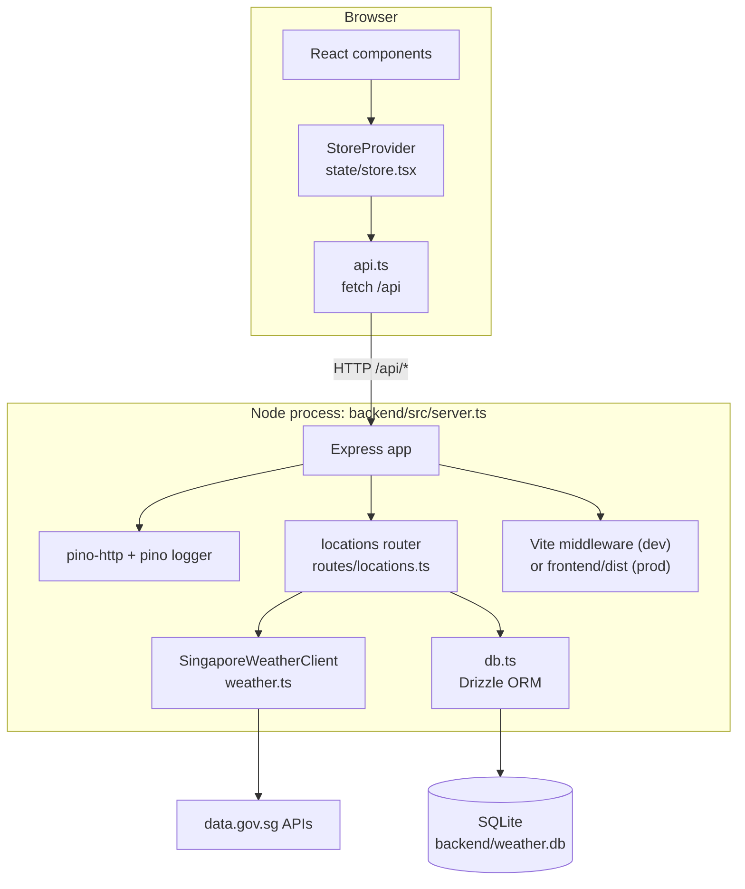
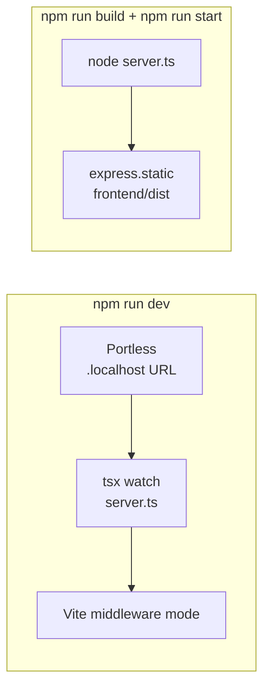
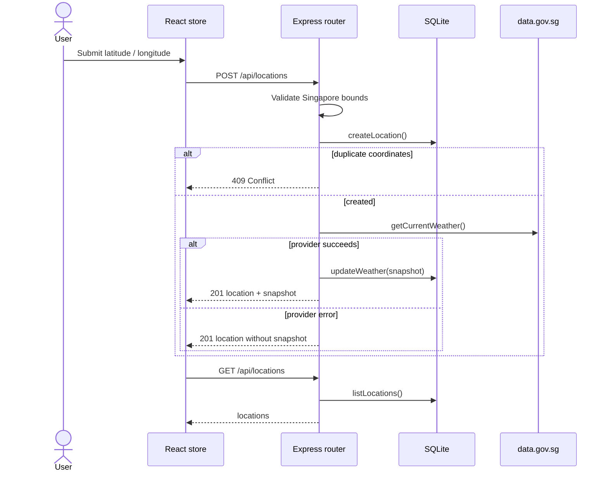
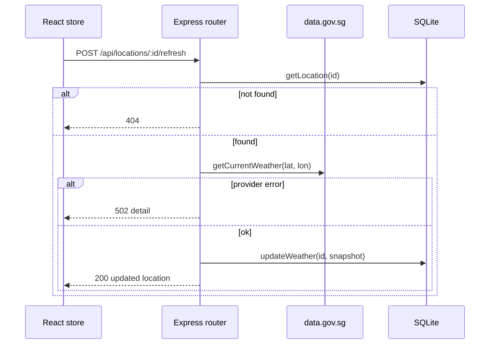

Backend and frontend run as a **single Node process** in development. In production, Express serves the built frontend from `frontend/dist`.

## Components

## Development vs production

## Creating a location

Weather is fetched only on **create** and **manual refresh**. Page loads read the saved snapshot.

## Refreshing a location

## Weather provider

`SingaporeWeatherClient` in `backend/src/weather.ts` builds one snapshot from several data.gov.sg endpoints:

- Nearest-station readings: air temperature, relative humidity, rainfall, wind speed, wind direction.
- UV index, PSI, and PM2.5.
- Two-hour and 24-hour forecasts, plus the 4-day forecast.

If the forecast payload fails, the client falls back to an empty forecast. If `WEATHER_API_KEY` is set it is sent as the `x-api-key` header. Failures surface as `WeatherProviderError`.

## Key files

| Path                              | Role                                                                    |
| --------------------------------- | ----------------------------------------------------------------------- |
| `backend/src/server.ts`           | App factory, `/health`, `/api/logs`, static/Vite serving, error handler |
| `backend/src/routes/locations.ts` | Location REST endpoints                                                 |
| `backend/src/weather.ts`          | Upstream client and response mapping                                    |
| `backend/src/db.ts`, `schema.ts`  | SQLite access and Drizzle schema                                        |
| `backend/src/logger.ts`           | pino logger                                                             |
| `frontend/src/`                   | React app                                                               |
| `scripts/`                        | dev, start, doctor, reset helpers                                       |
