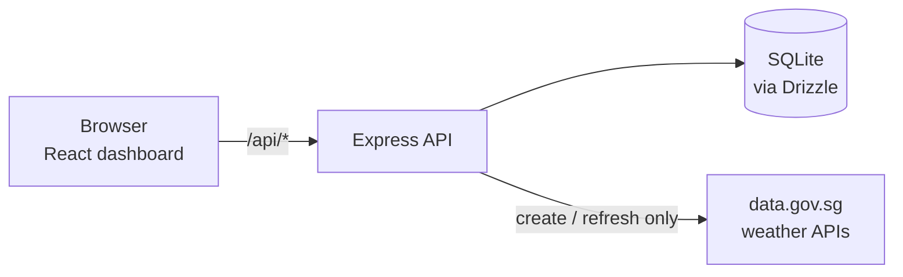

Weather Starter is a TypeScript app for saving Singapore locations (by latitude and longitude) and viewing the latest weather snapshot for each one. A React dashboard talks to an Express API, which stores locations and snapshots in SQLite and fetches fresh data from the Singapore [data.gov.sg](https://data.gov.sg) real-time APIs.

## Where to go next

- [Getting started](/guides/getting-started/): install, run, and test.
- [System architecture](/architecture/system/): processes, components, and data flow.
- [API reference](/reference/api/): REST endpoints.
- [Data model](/reference/data-model/): the `locations` table and snapshot shape.
- [Frontend](/architecture/frontend/): components and state.
- [Configuration](/reference/configuration/): environment variables and scripts.
