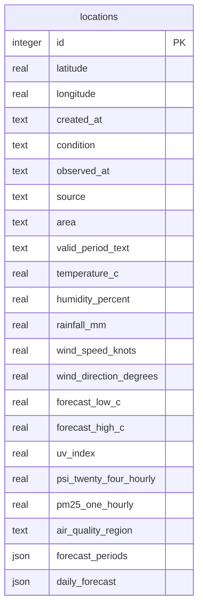

Drizzle defines the schema in `backend/src/schema.ts`; generated migrations live in `backend/drizzle/`.

A unique index (`locations_latitude_longitude_unique`) on `(latitude, longitude)` prevents duplicates. Each location row stores its latest weather snapshot inline; weather columns are nullable until the first successful refresh.

## JSON columns

- `forecast_periods`: array of `{ label, forecast }`.
- `daily_forecast`: array of `{ date, forecast, temperature_low_c, temperature_high_c }`.

Both are `NOT NULL` and default to empty arrays when no forecast is available.

## Changing the schema

1. Edit `backend/src/schema.ts`.
2. Run `npm run db:generate` and commit the migration.
3. Run `npm run db:migrate` to apply it.
4. Update the API tests and frontend types.

Do not commit local database files.
